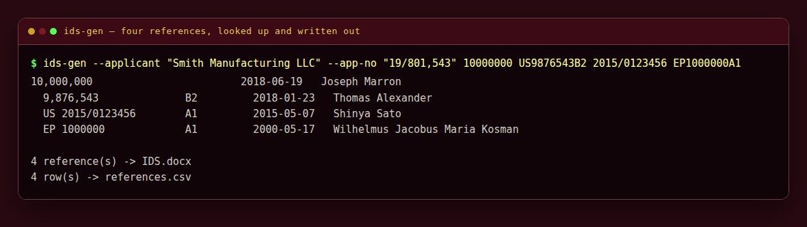
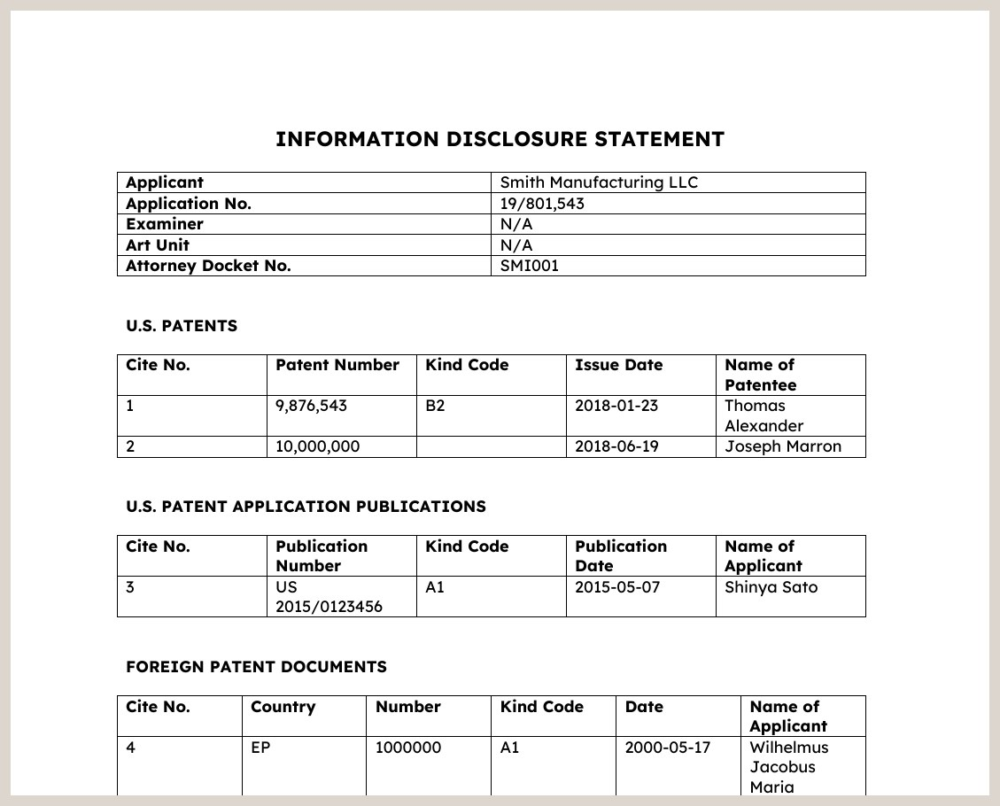

# Information Disclosure Statement Generator (Sienna)

*Why Sienna? The earth red of ink on an old docket card.*

**Runs on** any computer with Python — Windows, Mac or Linux.

**Version 1.0.**

Part of [Veered](https://veered.org): free tools, shared as-is. Questions: support@veered.org

Hand it the patent numbers you need to disclose and it writes the Information
Disclosure Statement for you: it looks each reference up, finds the dates and the
first named inventor, sorts them into the four tables the Patent Office expects,
numbers them straight through, and saves a Word document you can check, sign and file.



*It prints what it found for each reference as it goes, and tells you which ones it
could not find.*



*The Word document it saves. Open it, check it, add your signature, file it.*

> **Not legal advice, and not a substitute for reading the references.** This is a
> typing tool. Check every line against the document itself before you file anything,
> and check the rules in force when you file (37 CFR 1.97 and 1.98). Nothing is sent
> to the Patent Office by this program.

## What it does

- **You give it numbers**, in whatever shape they come in: `10000000`, `US 9,876,543 B2`,
  `2015/0123456`, `EP1234567A1`, or the name of a journal article.
- **It sorts them out.** US patents, US published applications, foreign documents and
  other literature each go to their own table, in number order, numbered 1, 2, 3... in
  one run across all four.
- **It fills in the dates and the inventor** from the published record for each patent,
  and says so plainly when it cannot find one, so nothing is quietly left blank.
- **It writes a Word document** — headings, the applicant block, the tables and the
  certification paragraph — that you finish in Word and file as usual.
- **It can read a folder** of prior-art PDFs and take the numbers from the file names,
  which is how they usually arrive.
- **It never files anything** and never touches the Patent Office.

## How you use it

One line, with the numbers:

```bash
python3 ids_gen.py --out IDS.docx --applicant "Smith Manufacturing LLC" \
    --app-no "19/801,543" --docket "SMI001" \
    10000000 US9876543B2 2015/0123456 EP1234567A1
```

Or from the folder the prior art already lives in:

```bash
python3 ids_gen.py --from-folder "Prior Art" --out IDS.docx --csv references.csv
```

It prints a line per reference as it goes, writes the document, and ends by naming
anything it could not look up so you can fill those in yourself.

## Information for nerds: options, lookups and tests

| Option | What it does |
| --- | --- |
| `numbers...` | References on the command line, in any of the shapes above |
| `--from-file FILE` | One reference per line; `#` starts a comment |
| `--from-folder DIR` | Take the numbers from the names of the PDFs in a folder |
| `-o, --out FILE` | The Word file to write (default `IDS.docx`) |
| `--csv FILE` | Also write what was found as a spreadsheet |
| `--applicant`, `--app-no`, `--filed`, `--title`, `--docket` | Fill in the header block |
| `--examiner`, `--art-unit` | Default to `N/A`, which is right for an application that has not been examined |
| `--attorney` | Name under the signature line |
| `--no-lookup` | Stay offline and list the numbers exactly as given |

**Where the data comes from.** Each patent's own published record on Google Patents,
read from the page's metadata: filing date (`DC.date scheme=dateSubmitted`), issue or
publication date, and the first named inventor. A granted patent carries its issue date
with `scheme="issue"`; a publication has a plain `DC.date` instead, and the program
knows the difference. There is a short pause between lookups, to be a polite visitor.
Anything it cannot find is listed at the end rather than left silently empty.

**Duplicates** are dropped: the same number given twice, or a number that also turns up
in the folder, is listed once.

**Requirements:** Python 3.9 or newer and `python-docx`
(`pip install python-docx`, or `sudo apt install python3-docx`).

**Tests:**

```bash
python3 -m unittest discover -s tests -v
```

They cover the classifying, the number shapes, the folder reading and the document
itself, and never go online.

## License

MIT. See [LICENSE](LICENSE). Written with AI assistance (Claude).
